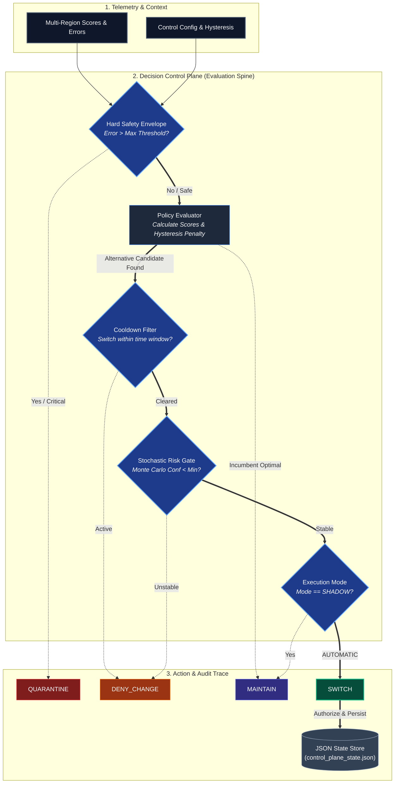

# Decision Control Plane (DCP)

Deterministic governance for infrastructure decisions under uncertainty.

## Overview

Modern infrastructure systems are effective at predicting metrics, but they remain far less reliable at deciding when it is safe to act.

Critical operational decisions (such as cloud region switches, cost optimizations, and scaling adjustments) are often executed through:

* Ad-hoc scripts
* Static thresholds
* Implicit human judgment
* Fragile conditional logic embedded in CI/CD pipelines

This approach breaks down when telemetry becomes noisy, incentives conflict, or systems operate at scale.

Decision Control Plane (DCP) introduces a dedicated governance kernel whose sole responsibility is to authorize or deny infrastructure modifications based on evaluated system stability rather than short-term optimization signals.

## What is DCP?

DCP is a deterministic governance engine that sits above execution layers. It evaluates candidate infrastructure actions and determines whether they are safe to execute under noisy operational conditions.

DCP does not perform execution actions directly. It authorizes, denies, or suppresses actions based on stability parameters.

## Core Philosophy

Trust is an emergent property of architecture.

DCP treats infrastructure decisions as a control theory problem rather than a pure prediction or optimization task. Its primary objective is preventing incorrect or premature execution under noise.

## System Responsibilities

### Capabilities

* Evaluates candidate infrastructure changes across candidate nodes or providers.
* Projects system stability using Monte Carlo stochastic simulation.
* Applies deterministic decision logic with hysteresis filters.
* Authorizes, denies, or suppresses execution based on formal thresholds.
* Emits structured decision reports for auditability and post-mortems.

### Non-Goals

* Cost optimization solver (DCP governs safety, not financial maximization).
* Self-tuning or online machine learning model.
* Replacement for orchestration layers (Kubernetes, Terraform, or cloud APIs).

## Architectural Principles

1. **Deterministic Governance:** Identical inputs and random seeds always yield identical decision outputs.
2. **Stability Over Reactivity:** Hysteresis filters prevent rapid oscillation (flapping) caused by transient metric spikes.
3. **Stochastic Risk Projection:** Monte Carlo simulation estimates stability risks prior to execution.
4. **Explicit Authority:** DCP maintains formal authority to deny changes even when short-term scores appear favorable.
5. **Native Auditability:** Every evaluation emits structured, traceable reports for compliance and post-mortem analysis.

## High-Level Architecture


## Example Decision Output
```text
DECISION CONTROL PLANE REPORT
========================================================================================
MODE            : AUTOMATIC
CONTROL TYPE    : DETERMINISTIC GOVERNANCE
ACTIVE PLATFORM : tokyo
========================================================================================

TRACE ID        : tx-377868
DECISION        : DENY_CHANGE
EVALUATED UNIT  : berlin
EXECUTING UNIT  : tokyo
RATIONALE       : Projected instability exceeds acceptable bounds.
CONFIDENCE      : 82.5%

----------------------------------------------------------------------------------------
Estimated Net Savings : $0.00 USD / month
FINAL OPERATING STATE : tokyo
========================================================================================
```

## Operational Modes

- AUTOMATIC: Decisions are evaluated, authorized, and state changes are persisted when stability criteria are satisfied.

- SHADOW: Decisions are evaluated and logged, but state changes are suppressed for validation and trust building.

## Project Structure
```text
decision-control-plane/
├── .github/
│   └── workflows/
│       └── ci.yml             # GitHub Actions CI pipeline
├── app/
│   └── main.py                # Demonstration entry point
├── core/
│   ├── domain.py              # Domain models and configurations
│   ├── enums.py               # Operational modes and decision types
│   └── ports.py               # Abstract port interfaces
├── governance/
│   ├── engine.py              # Core governance engine
│   └── evaluator.py           # Policy evaluator and hysteresis logic
├── infrastructure/
│   ├── clock.py               # System clock adapter
│   └── entropy.py             # Deterministic entropy source
├── simulation/
│   └── stability.py           # Monte Carlo stability analyzer
├── tests/
│   ├── test_evaluator.py      # Unit tests for policy evaluation
│   └── test_governance.py     # Unit tests for governance logic
├── conftest.py                # Pytest configuration
├── pyproject.toml             # Project metadata, linter, and test settings
├── requirements.txt           # Dependency specifications
├── LICENSE                    # Apache 2.0 License
└── README.md                  # System documentation
```

## Quickstart
### Prerequisites
Python 3.12 or higher

Virtual environment tool (venv)

### Setup and Execution

Clone the repository and navigate to the project root:
```bash
git clone [https://github.com/matiascloudarch/decision-control-plane.git](https://github.com/matiascloudarch/decision-control-plane.git)
cd decision-control-plane
```

Create and activate a virtual environment:
```bash
python3 -m venv .venv
source .venv/bin/activate
```

Install project dependencies:
```bash
pip install -r requirements.txt
```

Run the demonstration scenario:
```bash
python -m app.main
```

Run code quality checks and unit tests:
```bash
python -m ruff check .
python -m mypy core governance simulation
python -m pytest
```

## Author
Matías Salgado
Solutions Architect

## License
Licensed under the Apache License, Version 2.0. See the LICENSE file for complete terms and copyright details.